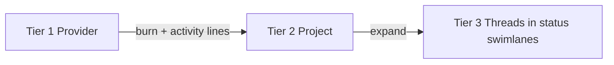

# Token flow — swimlane flow-control spec

> [!IMPORTANT] Proposal, not implemented.
> Doc-only turn. `views/` and `server.ts` are untouched; `npm test` is 102 pass and `npx tsc --noEmit` is clean. This mockup supersedes the family-fold/tiling direction, which the operator declined ("this isn't quite doing it").

## The goal (operator's words, this is the north star)

> The primary goal here is to see what the current token flow distribution looks like, in order to spot out-of-control threads. This is primarily a flow control display, with secondary benefits of seeing threads the operator may need to act on.

So the display is **flow control first**: make "which thread is running away" obvious at a glance. "Who needs me" is a secondary read, served by the status lanes.

## The hierarchy (three visible tiers)

The **family** level (parent + spawned children) drops out of the *visual* hierarchy. It survives in the data (`buildFamilies` still groups, and a thread row can still show the parent/child indent), but it is no longer a spatial container — the operator's list runs Provider → Project → Thread.

## 1. Status swimlanes (the four lanes)

Mapping the five `tokenFlowStatus` values into four lanes; Needs You absorbs error per the operator's call:

| Lane (left → right) | Source statuses | Color |
|---|---|---|
| **Working** | `running` | `--attn-working` (blue) |
| **Needs You** | `waiting`, `error`, `queued` | `--attn-needs-you` (amber), error shown with an `--attn-error` half-dot |
| **Unread** | `done`, `interrupted` | `--attn-unread` (green) |
| **Idle** | `idle` | grey ramp (age) |

**Working is far left**, i.e. closest to the incoming flow — the runaway threads and the links into them are the first thing the eye meets.

## 2. Collapsed project = a landscape card (Tier 2 at rest)

Each project is a card (~360×150). A card carries:

- a **provider-mix strip** (the project's token split by provider, on a shared scale),
- the project's **total tokens**,
- a live **tok/min** read (blue when moving, dim "quiet" when not),
- a **historical-burn sparkline** for the project's hottest thread over the window,
- a "click to open swimlanes" affordance.

**Flow lines, Tier 1 → Tier 2:** one line per provider contributing to the project.

- **thickness = historical burn** (the provider's share of the project's burn),
- **animated beads = current activity** (the provider's live rate),
- a quiet project's lines are dim and flat, so the eye lands on what is moving.

## 3. Expanded project = status swimlanes (Tier 3)

Expanding a card reveals four vertical lanes, Working leftmost.

- Each lane stacks that status's **thread cards** (dot, title, a **burn bar** = the thread's total on a shared scale, and a **tok/min** read).
- **Flow lines run from the Tier 2 header down to each Tier 3 card.** Concretely: a **provider flow bus** sits under the header (the incoming burn+activity, provider-mix), and each thread card hangs off the bus with a **vertical drop** (thickness = that thread's burn, beads = live). The drops are distributaries — they never cross each other.
- **The card's height is capped at the Working lane's height.** Working defines the card height; Needs You / Unread / Idle get the same lane height.
- **Each lane scrolls independently.** A lane whose threads exceed the lane height gets its own scroll rail; scrolling one lane never moves another.
- The out-of-control thread reads as the **fattest, brightest line** and the longest burn bar — the primary signal.

## 4. The hard problem, re-argued for this shape

The earlier spec's two broken invariants change character here:

- **Project bar ↔ candle run.** There is **no drawn project bar to the candles** any more. The project's quantity is the card: a total, a tok/min, a sparkline, and a provider-mix strip. The candle-run identity is gone by construction; it is not needed, because per-thread candles live in the lane thread cards. **This dissolves the invariant rather than patching it.**
- **Rivers.** The full provider→thread river is gone. Rivers now exist at two scales: **provider → project** (collapsed, the flow-control lines) and **header bus → thread card** (expanded, the distributary drops). Neither crosses arbitrarily. This is the operator's own decomposition: lines at the level you are looking at.
- **`droppedThreads`.** Retired. Overflow is absorbed by **lane scrolling** (expanded) and by the collapsed grid wrapping into rows. Nothing is hidden; the camera pans/zooms the world. Keep only a safety pitch-shrink ceiling as in the prior spec.

## 5. What is preserved

- **One thread = one card** (inside its lane).
- **No status-derived region fills** — region fill is neutral (`--attn-prov-zone`); status shows as dots and lane headers only. Provider strips and lines use `--attn-prov-*`, never status.
- **Idle age via the grey ramp.**
- **Line-work** stays confined to the flow view — and is now purposeful (the flow-control lines are the point).
- **Theme tokens only**, light + dark.
- Dashed beads mark live activity; a still lane has no beads.

## 6. Open questions for the operator

1. **Collapsed ordering:** order the project cards to minimise line crossings (e.g. by provider or by hotness) rather than alphabetically?
2. **Sparkline subject:** the collapsed card's sparkline currently shows the project's **hottest thread**; prefer the **project total** burn profile instead?
3. **Lane scroll affordance:** is the slim scroll rail enough, or should an overflowing lane show a "+N more" pill?
4. **Family:** keep the parent/child indent inside a thread card (data holds it), or drop families from the collapsed card entirely?
5. **Needs You ordering:** within the lane, sort by error-first (most urgent) or by recency?
