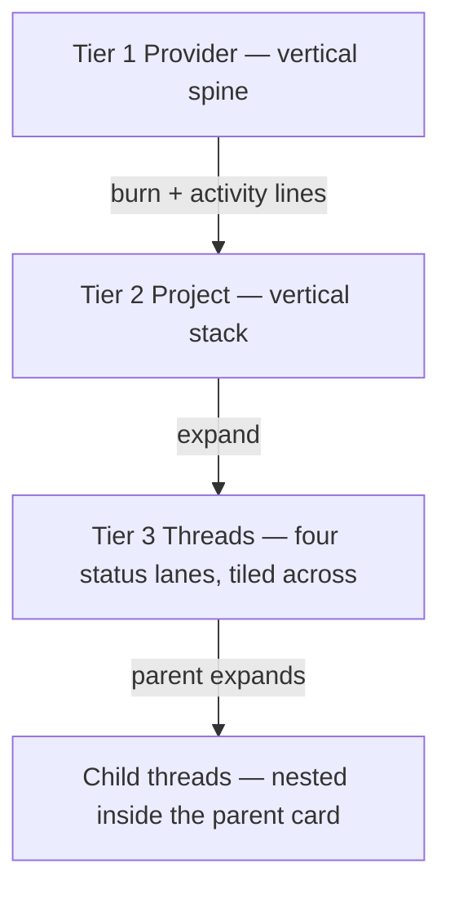

# Token flow — project stack + left-tree spec

> [!IMPORTANT] Proposal, not implemented.
> Doc-only. `views/` and `server.ts` are untouched; `npm test` is 102 pass and `npx tsc --noEmit` is clean.

## The goal (north star)

> The primary goal is to see what the current token flow distribution looks like, in order to spot out-of-control threads. This is primarily a flow control display, with secondary benefits of seeing threads the operator may need to act on.

## The shape (three tiers, two axes)

- **Projects pile vertically** — one wide landscape row each, **never tiled**. The row list *is* the stack; it scrolls/grows downward.
- **The tiers inside a project tile** — an expanded project opens its status lanes **across the row's width**.
- A **parent thread's children nest inside its card** (not a separate spatial tier), the containment **recursing to a grandchild and hard-capping there**, and the **rivers split** into them the same way threads branch from projects. The river into a thread carries **only that thread's own flow**; the card's total is the whole subtree.

This is the key correction from the prior pass: tiling belongs to the *tiers within a project*, not to the projects themselves.

## 1. Status lanes (the tiled tiers)

Five `tokenFlowStatus` values fold into four lanes; Needs You absorbs error (the operator's call):

| Lane (left → right) | Source statuses | Color |
|---|---|---|
| **Working** | `running` | `--attn-working` (blue) |
| **Needs You** | `waiting`, `error`, `queued` | `--attn-needs-you` (amber); error = `--attn-error` half-dot |
| **Unread** | `done`, `interrupted` | `--attn-unread` (green) |
| **Idle** | `idle` | grey ramp (age) |

**Working is far left**, closest to the incoming flow. Every lane sorts its threads **highest-consuming at the top** (the Working lane is where this matters most: the runaway thread is always the first row).

## 2. Collapsed project = one wide row (Tier 2 at rest)

A row (~full width × 94px) carries the project name, total tokens, live **tok/min**, thread/working counts, a **provider-mix strip**, and a **burn sparkline** for the hottest thread. Flow lines run provider → row: **thickness = historical burn, beads = current activity**. Quiet projects sit dim.

## 3. Expanded project = tiled status lanes (Tier 3)

Expanding a row reveals the four lanes across the width.

- Each lane stacks its thread cards (dot, title, subtree bar, tok/min).
- **The left-tree is drawn as sankey rivers.** All rivers fan from **one mouth** at the lane's top-left (fed by the project header) and land on each thread card: **a filled, provider-colored band whose thickness is that thread's own flow**, with white beads for live activity. Because the lane is sorted by flow, the runaway thread's river is the widest at the top. This is the primary read.
- **Row height is capped at the Working lane's height.** Needs You / Unread / Idle get the same height.
- **Each lane scrolls independently** (its own scroll rail); scrolling one lane never moves another.
- Needs You / Unread / Idle carry **no rivers** (they are not burning); they show their cards and counts only.
- No sky beam, and no pale connecting line: the flow is drawn as real sankey rivers in provider colors.

## 4. Nested children (contained, recursing to grandchildren)

A thread with children shows a `▸ N sub` / `▾ N nested` chip. Opened, its children are **contained inside the parent's card** (indented, not laid out as siblings), and the containment **recurses one further level**: parent → child → **grandchild**. **Hard cap at grandchild** (operator's call, `MAX_DEPTH = 2`): a grandchild does not open its own children. At each level:

- The **rivers split again** — a thin elbow inside the card drops to each child's own river — the same way threads branch from projects.
- **The river into a thread carries just that thread's OWN flow.** The **card's bar and total number show the whole-subtree sum** (own + every descendant shown). So a parent reads "own 15.8k tok/min · 46.5k total": the river that feeds it is its own, while its total includes its children. The two are deliberately different reads.
- Children stay inside the card; nesting is never a project-level tier.

## 5. Invariants preserved

- **One thread = one card** (inside its lane); a child lives inside its parent's card, at any depth.
- **No status-derived region fills** — lane/row fill is neutral; status shows only as dots and lane headers. Provider strips/branches use `--attn-prov-*`, never status.
- **Idle age via the grey ramp.**
- **Line-work** is confined to the flow view and is now the point (the left-tree lines).
- **Theme tokens only**, light + dark.
- Dashed beads mark live activity only.

## 6. What this retires

- **The project-bar↔candle-run invariant** (the tiled direction's headache): there is no drawn project bar to the candles. Per-thread consumption bars live in the lane cards; the collapsed row shows totals + a sparkline. The invariant dissolves.
- **`droppedThreads`**: overflow is absorbed by lane scrolling and the vertical project stack. Keep only a pitch-shrink safety ceiling.
- **`TOTAL_PX = 200`**: consumption bars are now lane-relative, not a fixed 200px artboard constant.

## 7. Open questions for the operator

1. **Stack order:** order project rows by hotness (busiest at top) rather than alphabetically?
2. **Lane sort:** every lane sorts by consumption (proposed) — or should Needs You sort error-first/most-urgent?
3. **Best-case confirm:** should an all-folded project with no live burn collapse to a single thin line instead of a full row?
4. **Nesting depth cap:** hard cap at grandchild (operator's call; `MAX_DEPTH = 2`) — confirmed. Anything deeper would be shown collapsed at the grandchild.
5. **Rows vs. columns for very wide panels:** cap the lane count at 4 (fixed) — confirmed?
