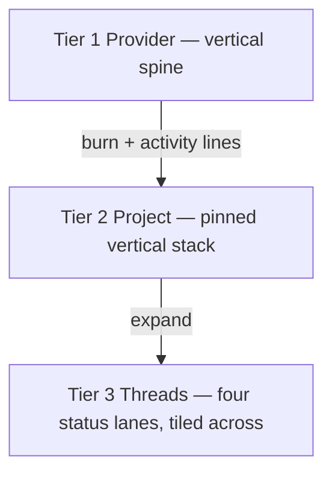

# Token flow — project stack + sky beam spec

> [!IMPORTANT] Proposal, not implemented.
> Doc-only. `views/` and `server.ts` are untouched; `npm test` is 102 pass and `npx tsc --noEmit` is clean. Three mockup passes landed here (tiled → swimlane cards → this): this note is the current one.

## The goal (north star)

> The primary goal is to see what the current token flow distribution looks like, in order to spot out-of-control threads. This is primarily a flow control display, with secondary benefits of seeing threads the operator may need to act on.

## The shape (three tiers, two axes)

- **Projects pile vertically** — one wide landscape row each, **never tiled**. The row list *is* the stack; it scrolls/grows downward.
- **The tiers inside a project tile** — an expanded project opens its status lanes **across the row's width**.
- The **family** level is not a spatial tier; a parent thread lives inside its lane card and can open its own nested beam (§4).

This is the key correction from the prior pass: tiling belongs to the *tiers within a project*, not to the projects themselves.

## 1. Status lanes (the tiled tiers)

Five `tokenFlowStatus` values fold into four lanes; Needs You absorbs error (the operator's call):

| Lane (left → right) | Source statuses | Color |
|---|---|---|
| **Working** | `running` | `--attn-working` (blue) |
| **Needs You** | `waiting`, `error`, `queued` | `--attn-needs-you` (amber); error = `--attn-error` half-dot |
| **Unread** | `done`, `interrupted` | `--attn-unread` (green) |
| **Idle** | `idle` | grey ramp (age) |

**Working is far left**, closest to the incoming flow. Every lane sorts its threads **highest-consuming at the top** (the Working lane is where this matters most: the runaway thread is always the first row).

## 2. Collapsed project = one wide row (Tier 2 at rest)

A row (~full width × 94px) carries the project name, total tokens, live **tok/min**, thread/working counts, a **provider-mix strip**, and a **burn sparkline** for the hottest thread. Flow lines run provider → row: **thickness = historical burn, beads = current activity**. Quiet projects sit dim.

## 3. Expanded project = tiled status lanes (Tier 3)

Expanding a row reveals the four lanes across the width.

- Each lane stacks its thread cards (dot, title, consumption bar, tok/min).
- **The sky beam:** the incoming flow enters the row header and falls as a **vertical beam** down the Working lane's left gutter — a bright trunk with a **stem into each thread card** (stem thickness = that thread's burn, beads = live activity). Because the lane is sorted by consumption, the beam is thickest and brightest at the top: the out-of-control thread leads. This is the primary read.
- **Row height is capped at the Working lane's height.** Needs You / Unread / Idle get the same height.
- **Each lane scrolls independently** (its own scroll rail); scrolling one lane never moves another.
- Needs You / Unread / Idle carry **no beam** (they are not burning); they show their cards and counts only.

## 4. Nested beam (a parent thread's working children)

A working thread that is a **parent** shows a `▸ N sub` chip. Opened, its card deploys a **nested sky beam** through its own working children — each child a smaller card with its own consumption bar and tok/min. Parent/child stays inside the card; it never becomes a project-level tier. (Recursion may continue, but the mockup shows one level; recommend clamping at one level in v1 for sanity.)

## 5. Invariants preserved

- **One thread = one card** (inside its lane).
- **No status-derived region fills** — lane/row fill is neutral; status shows only as dots and lane headers. Provider strips/stems use `--attn-prov-*`, never status.
- **Idle age via the grey ramp.**
- **Line-work** is confined to the flow view and is now the point (the flow-control lines and the beam).
- **Theme tokens only**, light + dark.
- Dashed beads mark live activity only.

## 6. What this retires

- **The project-bar↔candle-run invariant** (the tiled direction's headache): there is no drawn project bar to the candles. Per-thread consumption bars live in the lane cards; the collapsed row shows totals + a sparkline. The invariant dissolves.
- **`droppedThreads`**: overflow is absorbed by lane scrolling and the vertical project stack. Keep only a pitch-shrink safety ceiling.
- **`TOTAL_PX = 200`**: consumption bars are now lane-relative, not a fixed 200px artboard constant.

## 7. Open questions for the operator

1. **Stack order:** order project rows by hotness (busiest at top) rather than alphabetically?
2. **Lane sort:** every lane sorts by consumption (proposed) — or should Needs You sort error-first/most-urgent?
3. **Best-case confirm:** should an all-folded project with no live burn collapse to a single thin line instead of a full row?
4. **Nested depth:** clamp the nested beam at one level (proposed) or allow full recursion?
5. **Rows vs. columns for very wide panels:** cap the lane count at 4 (fixed) — confirmed?
