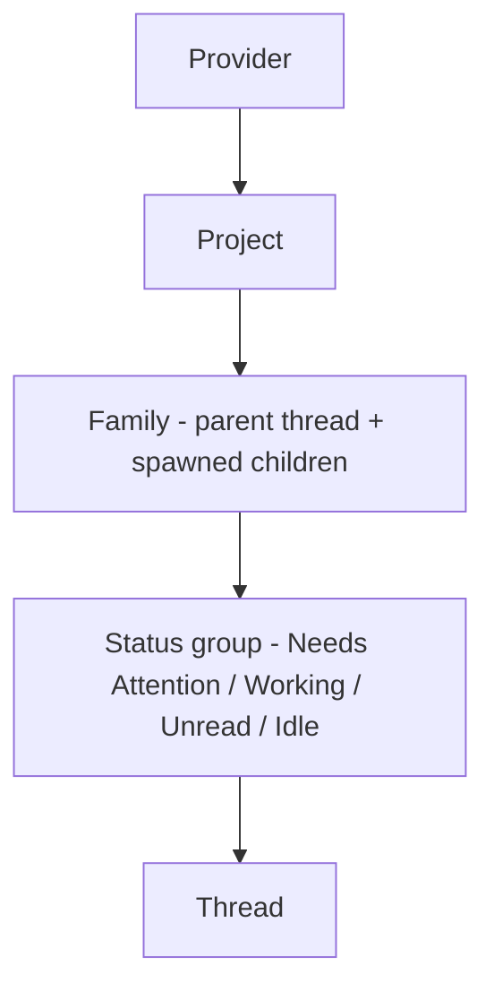

# Token flow — tiled hierarchy spec

> [!IMPORTANT] Proposal, not implemented.
> This turn is doc-only. `views/` and `server.ts` are untouched; `npm test` is 102 pass and `npx tsc --noEmit` is clean at dev `5365006`. The geometry below is **not built** until the operator approves the mockup. See the open questions at the end.

## Why

The operator reports two problems with the shipped token flow:

- **Family groups are too tall.** A family is a vertical rail of member rows; a roster of twenty families makes a world up to `H_MAX = 4600` and the overview stops working.
- **Height-first fights landscape displays.** The world only grows downward, spending the one dimension a landscape panel has least of.

The fix restructures the hierarchy and turns the growth axis to **width**: family cells tile into roughly landscape rectangles, and status becomes a fold level so a resting family is short.

## The hierarchy (five levels)



Levels 1–3 exist today (`providerOfModel` → project grouping → `buildFamilies`). Level 4 is new. Level 5 is the individual thread row.

## 1. Status-group mapping

`tokenFlowStatus` already folds the host shape statuses into five values. The operator's four groups fold those five as follows:

| Group | Source `tokenFlowStatus` values | Dot color | Rationale |
|---|---|---|---|
| **Needs Attention** | `waiting`, `error` | `--attn-needs-you` (amber) with an `--attn-error` (red) half-dot | Both mean "a human must act". One header keeps the operator's four-group list; the split dot (drawn in the mockup) carries the error distinction without a fifth group. |
| **Working** | `running` | `--attn-working` (blue) | Streaming now. |
| **Unread** | `done` | `--attn-unread` (green) | Finished, not yet read. |
| **Idle** | `idle` | grey ramp (age) | Resting. |

> [!NOTE] Deviation the operator should sign off
> The proposal merges `error` into Needs Attention. Error is arguably urgent enough to stand alone as a fifth group, but that reopens the operator's explicit four-group list, so the spec keeps four and represents error with a **two-tone header dot** (amber + red) instead. If you would rather error stand alone, say so and I will add a `Blocked` group; the fold machinery is group-count-agnostic.

## 2. Fold interaction (mechanism A)

- Each family cell renders its four **status-group headers** in a fixed order: Needs Attention, Working, Unread, Idle.
- **Default state: every group is folded.** A folded header shows its label and a count (`Needs Attention 2`). A family at rest is therefore four header rows — about **134 px** tall — not a rail.
- Clicking a header **expands** that group in that family only, revealing its thread rows (one row per thread). Clicking again folds it.
- **Folds are per-family and per-group.** A `Map<familyKey, Set<groupId>>` holds the expanded set; expanding one family's Working group never touches another family. The mockup's second panel shows exactly one open group.
- **Multiple groups in one family may be open at once.** The cell grows by `rows × ROW_H` for each open group. To keep the cell landscape, an expanded cell **claims a second grid column** (see §3).
- Keyboard/AT: each header is a button with `aria-expanded`; the row list is a labelled group.

## 3. Column tiling and the 16:7 target (mechanism B)

**Cell size.** A family cell is a fixed content box. The target aspect is 16:7.

- `CELL_W = 300 px` (the shipped `ZONE_W`), so the target height is `300 × 7 ÷ 16 ≈ 131 px`, matching a folded cell's four headers (~134 px). Folded cells are the landscape shape by construction.
- An **expanded** cell would exceed 16:7 if it grew downward, so it **spans two columns**: width `2·CELL_W + GUT = 620 px`, height ~134 + `n·26`. At 16:7 that height budget is `620 × 7 ÷ 16 ≈ 271 px`, i.e. room for about five open rows before it, too, outgrows the ratio. Past that, the cell spans a third column rather than growing taller. This is the rule that keeps the growth axis horizontal.

**Column count.** The panel reports its content width `availW`. Then

```
cols = max(1, floor((availW + GUT) / (CELL_W + GUT)))
```

With `CELL_W = 300`, `GUT = 20`: a 1680 px panel gives `floor(1700 / 320) = 5` columns (the mockup draws 4 for headroom); an 880 px panel gives 2. The mockup carries a four-column landscape panel, a two-column narrow panel, and a six-column large roster.

**Packing.** Families tile **left→right, top→bottom within their project section** — the same left-to-right reading a landscape panel wants. Each project is its own section (band header + its families' cells), so the grid is per project, not global; that keeps a project's families visually together. A cell that claims a second column reserves it, and a family that does not fit before the last column wraps to the next row.

**World size** becomes `W = gridLeft + cols·CELL_W + (cols-1)·GUT + margin` and `H = Σ section heights`. Width now scales with the panel and the row count, not with a fixed 1740 artboard — `W` is no longer a constant.

## 4. Recomputing the rivers and project bars (the hard problem)

Two shipped invariants are coupled to the single vertical rail and both break under tiling. This section is the argument the operator asked for.

### 4.1 The project bar's "run" is no longer a vertical extent

Today `p.h = burning ? Math.max(3, run) : Math.max(8, span, 3)` where `run` is the vertical extent the members' candles span. In a grid a project's members sit in **different columns**, so their candles' y-extents **overlap**; "the run" is not a single vertical measure any more. Keeping the formula would produce a bar whose height depends on which column a family landed in — an artifact of packing, not data.

**Resolution: retarget the project bar to a normalized token core.** The project bar becomes a **stacked bar of the project's total tokens split by provider** (`p.prov`, already computed), scaled **relative to the busiest project in view** — the same normalized-mix idea the family header's provider strip uses. It is drawn in the project band, not in a per-column position. Consequences:

- The bar is honest **about a different thing**: it shows the project's provider mix and relative size, not a pixel-faithful Σ of candles. The mockup labels it "tokens" and keeps an exact numeric label, so nothing is lost to the eye.
- **The candle-to-bar identity is retired, by design.** The old invariant (a project's candle run equals its bar) cannot survive a grid. Candles remain per-thread and honest; the project bar becomes a summary.

> [!WARNING] This is the real cost of the change.
> Per-thread candles keep exact proportions (the `TOTAL_PX = 200` design constant is unchanged). The **project bar loses its exact proportion to the candles**. If the operator wants an exact project-level quantity, the honest alternative is a numeric column in the band and no drawn bar — say which you prefer.

### 4.2 Rivers in a grid

Today a river is a cubic provider-slot → project-slice → one card row. Tiling scatters card rows, so a faithful "provider to thread" river would run across columns and cross its neighbours — visible in the mockup's variant (i) panel.

**Resolution: truncate the rivers at the project band.** Rivers run **provider → project band only** (one filled band per provider present in the project, width ∝ that provider's project tokens on a shared scale), and they **end at the band**. The band's provider strip carries the mix onward; the family header's provider strip carries it to the cell. Nothing is drawn from the band into the grid.

- Rationale: this is the operator's own list taken seriously. Provider and Project are **levels**; only the top two are worth a spatial lane. Below the project, the hierarchy is already encoded by **nesting** (a cell inside a section) and by **color** (the provider strips), so a drawn river would be redundant *and* crossy. The mockup shows two clean curves per project instead of twenty tangled ones.
- This satisfies the standing invariant: the flow view stays the one place line-work is allowed (bands + the family strips), and there is **less** line-work than today, not more.
- The btn "A/B/C encodings" survive at the **river** level (the provider→project band keeps A's per-interval profile / B's totals / C's crest). The per-thread burn profile still lives in the family's expanded rows (the row total bar) and in the candles.

The mockup draws **both** resolutions so the choice is visible:

- **Variant (i), rail-only tiling** (drawn, not recommended): keeps the three columns and tiles only the card rail. It shows the two problems directly — the project bar's run is meaningless (members span columns) and every river gains two bends and crossings.
- **Chosen shape, band-truncated rivers** (drawn, recommended): dissolve the middle/left *columns* into project **sections**; provider survives as the spine, the band's strip, the family strip, and cell tint.

## 5. Crowding fallback (`droppedThreads`)

Today, when even the thinnest rows overflow `H_MAX = 4600`, the smallest families are dropped and reported as "N smaller threads hidden".

**Proposal: retire `droppedThreads` under tiling.** Tiling into rows removes the failure mode that motivated it: overflow is now absorbed by **more rows and a taller world** (or, on a narrower panel, fewer columns and a taller world), and the camera pans and zooms the whole world regardless. Nothing needs hiding.

- The world is already a pannable map, so a tall world is a camera problem, not a data problem.
- Keep a **safety ceiling** (`H_MAX`, raised to e.g. 20000) purely to stop runaway sculpts on a pathological host, but at the ceiling **shrink the row pitch** rather than drop families, and only if even the floor overflows report a hidden count. So the honest fallback survives as a last resort; it should essentially never fire.

> [!NOTE] If you want a hard cap instead
> The alternative is to keep `droppedThreads` exactly as-is and tile only until the cap. I recommend retiring it, because the operator's whole complaint is "too tall", and the cure is more columns, which tiling provides.

## 6. What is preserved

- **One thread = one row** (inside its status group).
- **No status-derived region fills.** Region fill stays `--attn-prov-zone` (neutral); status appears only as dots on headers and rows, exactly as today. The provider strips and the project bar use `--attn-prov-*`, never status.
- **Idle age via the grey ramp** (`--attn-grey-0…5`), never extra hues.
- **Line-work** stays confined to the flow view's rivers and strips — and there is less of it.
- **Theme tokens only**, light + dark, via `views/theme.ts`. No hardcoded hexes in the view.
- **Selection lighting**: clicking a family still highlights only that family's rows/candles; hover lifts provider/project/family as today.

## 7. Questions for the operator

1. **Error as its own group?** Keep the four-group merge (error folded into Needs Attention, two-tone dot) or add a fifth `Blocked` group?
2. **Project bar:** accept the normalized provider-mix bar (recommended, keeps a bar), or drop the drawn bar entirely for a numeric column (exact, no bar)?
3. **Rivers:** approve truncating rivers at the project band (recommended), or keep full provider→thread rivers with the crossings variant (i) shows?
4. **`droppedThreads`:** retire it for unbounded rows with a pitch-shrink safety ceiling (recommended), or keep the hard drop cap?
5. **Expanded cell growth:** the "claim another column" rule keeps cells landscape; is a full-width row band for an expanded family ever preferable?
